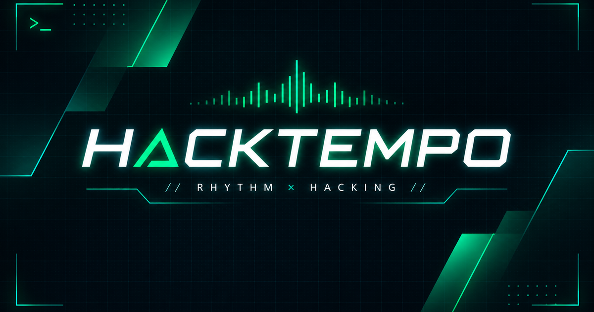

# HACKTEMPO v3.0.0

**正しく打つな、激しく叩け！…だが拍子（リズム）を外すな！**

HACKTEMPOは、映画の「天才ハッカーになりきってキーボードを猛烈に叩く」体験とリズムゲームを組み合わせた、ブラウザで遊べるサイバーリズム・タイピングアクションです。PCのキーボードでもスマートフォンのタッチ操作でもプレイできます。



**[▶ ゲームをプレイ](https://tanzyyy-dev.github.io/hacktempo/)**

## v3.0.0 の主な機能

- **3難易度・3楽曲**：EASY / NORMAL / HARD。それぞれ異なるテンポ・譜面・音楽でプレイできます。
- **デュアル・リズムハイウェイ**：SHIFT専用レーンとメインレーンで、色とタイミングを見ながら打鍵します。
- **リアルタイム判定**：PERFECT / GREAT / GOOD / MISS とペナルティを判定。リズム同期率や最高打鍵速度などを集計します。
- **スマホ対応**：画面をゲームプレイ中心に整理し、大きな4つのタッチボタンを用意しました。
- **中断・再開**：ゲーム中にEscキー、または画面の「中断」ボタンで一時停止。再開するか、ミッション選択に戻れます。
- **誤操作の軽減**：ゲーム中はファンクションキーやブラウザショートカットを、ブラウザで可能な範囲で抑止します。OSが優先する操作は抑止できません。
- **シンプルなリザルト**：ランク・スコア・同期率・最高速度を中心に表示。詳細成績の展開、リトライ、テキストコピー、認定証PNGの保存、Xへの共有に対応しています。

## 遊び方

1. TOP画面で難易度を選び、「START」からミッションを開始します。
2. 流れてくるノーツが判定ラインに重なるタイミングで、対応するキーやボタンを押します。
3. 曲が終わるとランク・スコア・プレイ統計が表示されます。

| 表示色 | キー・操作 | 役割 |
| --- | --- | --- |
| 🟢 緑 | 通常の文字・記号キー / 連打ボタン | メインの連打 |
| 🟡 黄 | Space / SPACEボタン | スペース |
| 🟣 紫 | Shift / SHIFTボタン | SHIFTレーン |
| 🔴 赤 | Enter / ENTERボタン | 決めの入力 |

**PC**：Escで中断・再開できます。ブラウザやOSの予約済みショートカットを完全に無効化することはできません。

**スマートフォン**：画面下部の4ボタンでキーボードなしでも遊べます。「中断」ボタンから一時停止できます。

## 難易度と音楽

| 難易度 | スタイル | BPM | ゲーム時間 |
| --- | --- | ---: | ---: |
| EASY | Chillout Synthwave | 118 | 約35秒 |
| NORMAL | Electro Cyberpunk | 134 | 約48秒 |
| HARD | Drum & Bass Overdrive | 165 | 約56秒 |

楽曲はGoogle Geminiを使用して生成しています。音声ファイルの読み込みに失敗した場合は、Web Audio APIによるプロシージャル音源へフォールバックします。

## 技術スタック

- TypeScript（strict mode）
- Vite 8
- Vanilla HTML / CSS
- Web Audio API（楽曲再生・効果音）
- Canvas API（レーダー演出・認定証画像）
- GitHub Pages（公開）

ランタイムの外部フレームワークに依存しない、クライアントサイドのゲームです。

## ローカルで起動

Node.js 22以降を推奨します。

```bash
npm ci
npm run dev
```

```bash
npm run build
npm run preview
```

## プロジェクト資料

- [AGENTS.md](./AGENTS.md) — アーキテクチャ・開発ガイド
- [.agents/rules/ui-guidelines.md](./.agents/rules/ui-guidelines.md) — UI設計ルール

## ライセンス・音源について

**ソースコード**は [MIT License](./LICENSE) で公開します。

**収録音源**（`public/audio/`）はGoogle Geminiを用いて生成したものです。ソースコードに適用されるMIT Licenseによって音源の利用条件まで一律に許諾するものではありません。音源の利用に際しては、生成に使用したサービスに適用されるGoogleの利用規約・ポリシーを確認してください。音源について、無条件の再配布・商用利用権を保証するものではありません。

本作品はフィクションのエンターテインメントであり、実際の不正アクセスを目的とするものではありません。
